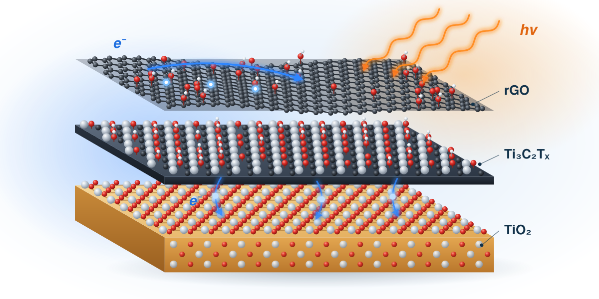
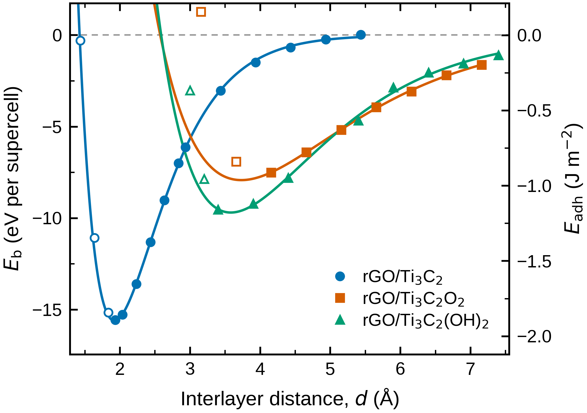
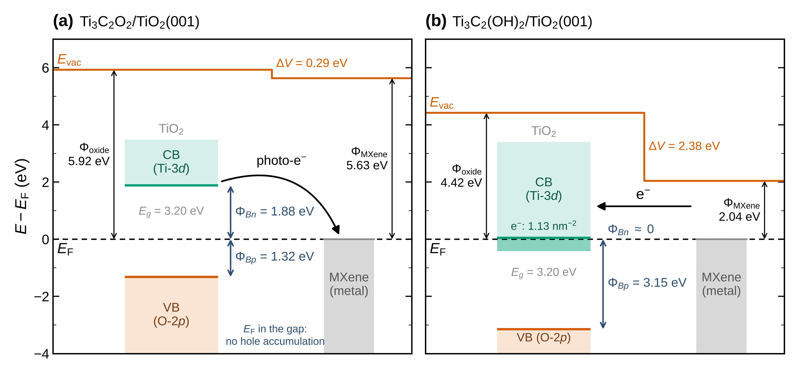
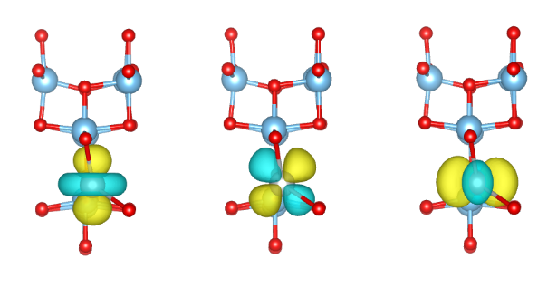

# Avazkhon Azamjonov — Computational Materials Scientist

I use first-principles (DFT) calculations and machine learning to understand and design new materials for various applications.

Research Fellow, Institute of Materials Science, Uzbekistan Academy of Sciences.

  
   rGO / Ti₃C₂Tₓ MXene / anatase TiO₂: light absorption and charge transfer across the interfaces.

---

## Research overview

### Interface-driven electronic and optical properties of graphene–MXene–metal oxide heterostructures

Most energy devices are limited by their interfaces, the few ångströms where two different materials meet. Using first-principles calculations in one consistent protocol, this work shows how doping, strain and surface termination control the electronic and optical properties of anatase TiO₂, Ti₃C₂ MXene, reduced graphene oxide (rGO) and the contacts between them. All models are compared on the same protocol.

### Main findings

- **Doped TiO₂.** In Cu- and Ag-doped anatase TiO₂ the two dopants are told apart by the Wannier spread, not by the band gap. Ag disturbs the host lattice less, and under 5 % compression the electron mobility reaches about **750 cm²·V⁻¹·s⁻¹**.
- **MXene/TiO₂ contacts.** The termination of Ti₃C₂ selects the type of its contact with TiO₂(001): oxygen termination gives a **Schottky barrier of 1.88 eV** for electrons, while hydroxyl termination gives an **ohmic contact** and transfers electrons into the oxide.
- **MXene/rGO binding.** Termination switches the binding of Ti₃C₂ to rGO between chemisorption on the bare surface (**1.90 J·m⁻²** at 1.92 Å) and dispersion binding on the terminated surfaces (0.96 and 1.18 J·m⁻²). On the bare surface, oxygen atoms move from rGO to the carbide.
- **Tunable work function.** The work function of rGO/Ti₃C₂Tₓ can be tuned over about **1.9 eV** (3.93 to 5.86 eV) by changing a single atomic layer, and the stack absorbs 57 to 69 % less visible light than the sum of its layers.

**Methods:** Quantum ESPRESSO;  PBE+D3(BJ);  GGA+U;  Maximally Localized Wannier Functions;  dipole correction;  UBER fit;  charge-density difference

---

## Projects

| Project | Status | Summary |
|---|---|---|
| **How surface termination binds MXene to reduced graphene oxide** | Published | One rGO sheet (C/O = 5) on bare, O- and OH-terminated Ti₃C₂ in a single supercell (0.20 % mismatch). The bare surface binds chemically and strips oxygen; terminated surfaces bind by dispersion at ~3.6–3.7 Å. Oxygen groups roughly double the adhesion compared with pristine graphene. |
| **MXene contacts on anatase TiO₂(001): Schottky or ohmic** | Completed | Dipole-corrected interfaces of O- and OH-terminated Ti₃C₂ with TiO₂(001). O termination leaves the Fermi level in the oxide gap (barrier for electrons); OH termination pins it at the conduction-band edge. Oxide bands shift by 1.8–2.0 eV with the gap unchanged. |
| **Strain-modulated hybridization in Cu- and Ag-doped anatase TiO₂** | Published | Doping narrows the gap from ~3.2 eV to 3.1 eV (Ag) and 3.0 eV (Cu). Wannier functions show Cu perturbs the states more strongly, and compression strengthens dopant–host hybridization. Compressed Ag-doped TiO₂ has the lightest electrons and highest mobility. |
| **Adsorption of small molecules on transition-metal surfaces** | Published | Spin-polarized DFT of a water molecule on Co, Ni, Pd and Pt (100)/(110). Co binds water most strongly, Pt most weakly; the on-top site is preferred; magnetic metals need two spin-resolved d-band centres. Related work covers O₂ and CO₂ on Pt facets. |
| **Machine-learning-guided discovery of Janus MXenes** | Ongoing | Prototype-based generation of Janus MXenes, screening with materials descriptors and ensemble ML models, and spin-polarized DFT validation, targeting photocatalytic water splitting and hydrogen adsorption. |

  
  
  

---

## Publications

### Journal articles

1. **A.A. Azamjonov**, L. Khoroshko, O. Ruzimuradov, Sh.I. Mamatkulov. *Strain-modulated hybridization and electronic dispersion in Cu- and Ag-doped anatase TiO₂: A Wannier-function perspective.* **Next Materials** 12, 102202 (2026). [doi:10.1016/j.nxmate.2026.102202](https://doi.org/10.1016/j.nxmate.2026.102202)
2. **A.A. Azamjonov**, Kh.T. Butanov, Sh.I. Mamatkulov. *DFT study: mechanism of adsorption of a single water molecule on transition metal surfaces.* **Physica E: Low-dimensional Systems and Nanostructures** 182, 116580 (2026). [doi:10.1016/j.physe.2026.116580](https://doi.org/10.1016/j.physe.2026.116580)
3. **A.A. Azamjonov**, D.G. Khajibaev. *First-principles investigation of Ti₃C₂Tₓ/rGO heterostructures: effect of surface termination on electronic and optical properties.* **Journal of Fundamental and Applied Research** 6(3), 20260304 (2026). [doi:10.35938/JFAR-2026-3-00004](https://doi.org/10.35938/JFAR-2026-3-00004)
4. **A.A. Azamjonov**, A.A. Narzullayev. *Electronic and optical properties of graphene and Ti₃C₂ MXene systems.* **Scientific Bulletin of Namangan State University**, No. 4, 29–33 (2026).
5. **A.A. Azamjonov**, Sh.I. Mamatkulov. *Theoretical study of the electronic and optical properties of Cu-doped anatase TiO₂ using DFT.* **Uzbek Journal of Modern Physics** 2(2), 12–17 (2025).

### Conference papers

6. **A.A. Azamjonov**. *CO₂ monomer adsorption on Pt(100) and Pt(110) facets: a spin-polarized DFT and d-band analysis.* International scientific-practical conference, TDTU, Tashkent, 34–38 (2025).
7. **A.A. Azamjonov**. *Oxygen adsorption on Pt(100) and Pt(111): distance-scan and coverage effects from spin-polarized DFT.* II International Scientific-Technical Conference "New horizons of low-carbon development in the world and in Uzbekistan", Tashkent, 204–207 (2025).
8. **A.A. Azamjonov**, L.S. Khoroshko, Sh.I. Mamatkulov. *The electronic structure modification and photocatalytic ability improvement of titanium dioxide doped with silver and copper atoms.* EDA Conference 2024, BSUIR, Minsk, 87–91 (2024).
9. **A.A. Azamjonov**. *Enhancing the electronic structure of Cu-doped TiO₂ based on DFT calculations.* Uzbek–Chinese Scientific Forum on New Materials, Tashkent–Parkent, 52–53 (2024).

---

## Open-source tools

Python scripts I wrote for interface calculations with Quantum ESPRESSO, free to use and adapt ([`files/scripts/`](files/scripts/)):

| Script | What it does |
|---|---|
| [`make_heterostructure.py`](files/scripts/make_heterostructure.py) | Builds an MXene/anatase TiO₂(001) interface from two CIF files and writes QE inputs for the interface and both references |
| [`make_dipole_scf.py`](files/scripts/make_dipole_scf.py) | Turns a finished relaxation into a dipole-corrected SCF input for work-function calculations |
| [`phi_two_faces.py`](files/scripts/phi_two_faces.py) | Work function of both faces of an asymmetric slab, with vacuum-flatness and convergence checks |
| [`make_post_inputs.py`](files/scripts/make_post_inputs.py) | Writes pp.x, average.x, projwfc.x and fragment reference inputs for a converged interface |
| [`adhesion.py`](files/scripts/adhesion.py) | Adhesion energy (work of separation) from three SCF outputs, with consistency checks |
| [`charge_transfer.py`](files/scripts/charge_transfer.py) | Electrons transferred across an interface from the plane-averaged charge-density difference |
| [`fragment_pdos.py`](files/scripts/fragment_pdos.py) | Projected DOS per fragment and element, saved as CSV |
| [`interface_contacts.py`](files/scripts/interface_contacts.py) | Shortest atomic contacts across an interface, including in-plane periodic images |

---

## Skills

- **Simulation:** Quantum ESPRESSO, CASTEP, Wannier90, DFT+U, dipole correction, ASE, MACE-MP-0
- **Data and ML:** Python, pymatgen, Matminer, Materials Project API, Random Forest, graph neural networks
- **Experiment:** hydrothermal synthesis, XRD, SEM, UV-Vis

---

This repository also contains the source of my personal website (English, Uzbek and Russian), with research details, tutorials and notes.
